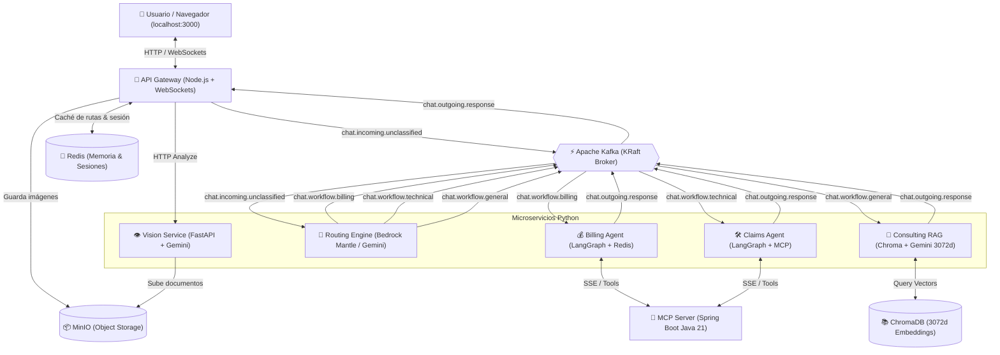
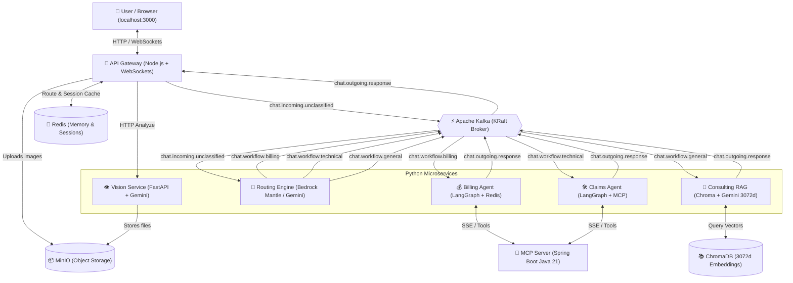

# ⚡ Electric Service — AI Customer Care Architecture
> Plataforma de Atención al Cliente para Distribución Eléctrica basada en Microservicios Event-Driven y Arquitectura Hexagonal Pura (Ports & Adapters).

[](https://github.com/facuvgaa/energy-ai-customer-service/actions/workflows/ci.yml)
[](file:///home/facuvega/Documents/electric-service/docker-compose.yml)
[](https://python.org)
[](https://nodejs.org)
[-6DB33F?logo=springboot)](https://spring.io)
[](https://trychroma.com)

---

## 🌐 Language / Idioma
- [Español (ES)](#-español)
- [English (EN)](#-english)

---

# 🇪🇸 Español

## 1. Visión General
**Electric Service** es un ecosistema distribuido diseñado para la atención integral de usuarios de servicios eléctricos (basado en normativas reales de **EDET S.A.**). Gestiona de manera autónoma e inteligente:
1. **Facturación y Deudas:** Consulta de estados de cuenta, facturas impagas y validación de comprobantes de pago.
2. **Reclamos Técnicos:** Detección de fallas en red eléctrica, peligro en vía pública y cortes de suministro.
3. **Consultas Comerciales (RAG):** Respuestas normativas fundamentadas sobre cuadros tarifarios, cambio de titularidad, planes de pago y trámites comerciales utilizando embeddings de 3072 dimensiones.
4. **Visión Multimodal (OCR):** Extracción automatizada de números de servicio, montos y números de transacción desde fotos o PDFs de facturas y tickets bancarios.

---

## 2. Diagrama de Arquitectura



---

## 3. Microservicios del Ecosistema

| Microservicio | Tecnología | Rol Principal |
| :--- | :--- | :--- |
| **`api-gateway`** | Node.js 20, Express, Socket.IO, KafkaJS | Frontend web, autenticación JWT, WebSockets y despacho a Kafka. |
| **`routing`** | Python 3.12, aiokafka, Bedrock Mantle / Gemini | Clasificación semántica de intenciones y ruteo a tópicos específicos. |
| **`vision`** | Python 3.12, FastAPI, Google Gemini Vision | OCR multimodal para tickets de pago y facturas eléctricas; subida a MinIO. |
| **`billing`** | Python 3.12, LangGraph, Redis, MCP | Asistente de facturación, reconexiones urgentes y validación de deudas. |
| **`claims`** | Python 3.12, LangGraph, MCP Client | Gestión de reclamos técnicos y priorización de emergencias en vía pública. |
| **`consulting`** | Python 3.12, ChromaDB, Gemini Embeddings, Bedrock | Pipeline RAG sobre resoluciones y reglamentaciones comerciales de EDET S.A. |
| **`demo` (mcp-service)** | Spring Boot 3.3, Java 21, H2/JPA | Servidor MCP (Model Context Protocol) por SSE para consulta de datos y reclamos. |

---

## 4. Tópicos de Kafka

- `chat.incoming.unclassified`: Mensajes iniciales de usuarios sin categoría definida.
- `chat.session.routed`: Notificación de fijación de ruta para sesiones recurrentes.
- `chat.workflow.billing`: Flujo de facturación, tarifas y pagos.
- `chat.workflow.technical`: Reclamos técnicos, cortes y cables caídos.
- `chat.workflow.general`: Consultas comerciales y trámites normativos (RAG).
- `chat.outgoing.response`: Respuestas finales de los agentes dirigidas al API Gateway para emisión por WebSocket al usuario.

---

## 5. Puesta en Marcha Local con Docker Compose

Toda la infraestructura y los microservicios se compilan y levantan con un único comando:

```bash
docker compose up --build -d
```

### Servicios Disponibles:
- **Frontend & Chat Web:** [http://localhost:3000](http://localhost:3000)
- **MinIO Console:** [http://localhost:9001](http://localhost:9001) (`minioadmin` / `minioadmin`)
- **ChromaDB:** [http://localhost:8000](http://localhost:8000)
- **Langfuse Tracing:** [http://localhost:3100](http://localhost:3100)
- **MCP Server SSE:** `http://localhost:8080/sse`
- **Apache Kafka:** `localhost:9092` (Host) y `kafka:29092` (Docker Network)

---

## 6. Pruebas Unitarias
Cada microservicio cuenta con sus tests unitarios aislados bajo Arquitectura Hexagonal:

```bash
# Billing
cd billing && python -m pytest -v tests/

# Claims
cd claims && python -m pytest -v tests/

# Consulting
cd consulting && python -m pytest -v tests/
```

---

## 7. CI/CD & GitHub Container Registry (GHCR)
El workflow en `.github/workflows/ci.yml` ejecuta en cada push a `main`:
1. **Matriz de tests unitarios** en Python 3.12 (`billing`, `claims`, `consulting`).
2. **Build & Push automático** de las imágenes Docker a `ghcr.io`:
   - `ghcr.io/<owner>/routing:latest`
   - `ghcr.io/<owner>/vision:latest`
   - `ghcr.io/<owner>/billing:latest`
   - `ghcr.io/<owner>/claims:latest`
   - `ghcr.io/<owner>/consulting:latest`
   - `ghcr.io/<owner>/api-gateway:latest`

---

# 🇬🇧 English

## 1. Overview
**Electric Service** is an event-driven distributed system designed for comprehensive customer support in electric power distribution (grounded in official **EDET S.A.** regulations). It autonomously handles:
1. **Billing & Debts:** Account balance inquiries, unpaid invoices, and payment receipt reconciliation.
2. **Technical Claims:** Outage reports, hazardous power lines on public roads, and emergency technician dispatching.
3. **Commercial Inquiries (RAG):** Retrieval-Augmented Generation over regulatory documentation using 3072-dimensional vector embeddings.
4. **Multimodal Vision AI (OCR):** Automated extraction of service numbers, amounts, and transaction IDs from invoice and payment receipt images/PDFs.

---

## 2. Architecture Diagram



---

## 3. Microservices Breakdown

| Microservice | Technology | Key Responsibility |
| :--- | :--- | :--- |
| **`api-gateway`** | Node.js 20, Express, Socket.IO, KafkaJS | Frontend web interface, JWT auth, WebSockets, Kafka message publishing. |
| **`routing`** | Python 3.12, aiokafka, Bedrock Mantle / Gemini | Semantic intent classification and dynamic Kafka topic routing. |
| **`vision`** | Python 3.12, FastAPI, Google Gemini Vision | Multimodal document extraction for invoices/receipts and MinIO storage. |
| **`billing`** | Python 3.12, LangGraph, Redis, MCP | Billing conversational agent, debt lookup, and urgent reconnection claims. |
| **`claims`** | Python 3.12, LangGraph, MCP Client | Technical claims assistant, power failure diagnosis, and public safety issues. |
| **`consulting`** | Python 3.12, ChromaDB, Gemini Embeddings, Bedrock | RAG pipeline over EDET commercial PDFs using 3072d embeddings. |
| **`demo` (mcp-service)** | Spring Boot 3.3, Java 21, H2/JPA | Model Context Protocol (MCP) SSE Server exposing database tools. |

---

## 4. Kafka Topics Architecture

- `chat.incoming.unclassified`: Initial incoming user messages without an assigned workflow.
- `chat.session.routed`: Route caching notification to lock the session to an agent.
- `chat.workflow.billing`: Billing, payments, and reconnection workflow.
- `chat.workflow.technical`: Power outages and hazardous network conditions.
- `chat.workflow.general`: Commercial inquiries and regulatory FAQs (RAG).
- `chat.outgoing.response`: Outgoing agent responses routed to the API Gateway.

---

## 5. Local Setup via Docker Compose

Run the entire cluster with a single command:

```bash
docker compose up --build -d
```

### Access URLs:
- **Chat Web UI:** [http://localhost:3000](http://localhost:3000)
- **MinIO Console:** [http://localhost:9001](http://localhost:9001) (`minioadmin` / `minioadmin`)
- **ChromaDB API:** [http://localhost:8000](http://localhost:8000)
- **Langfuse Tracing:** [http://localhost:3100](http://localhost:3100)
- **MCP Server SSE:** `http://localhost:8080/sse`
- **Apache Kafka:** `localhost:9092` (Host) & `kafka:29092` (Docker Network)

---

## 6. Running Unit Tests

```bash
# Billing Service
cd billing && python -m pytest -v tests/

# Claims Service
cd claims && python -m pytest -v tests/

# Consulting Service
cd consulting && python -m pytest -v tests/
```

---

## 7. CI/CD & Docker Publish (GHCR)
The GitHub Actions workflow (`.github/workflows/ci.yml`) runs on pushes to `main`:
1. **Parallel matrix testing** on Python 3.12 for all services.
2. **Build and push** of Docker images to GitHub Container Registry (`ghcr.io`).
